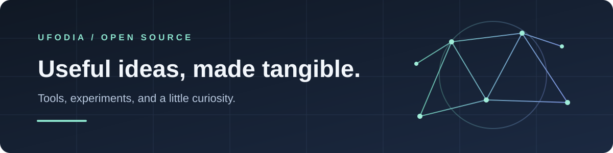

  

  I build open-source tools and experiments for people who like to understand how things work — and make them work better.

  <a href="#ai--developer-workflows"><strong>AI &amp; developer tools</strong></a> &nbsp;·&nbsp;
  <a href="#documents--data"><strong>Documents &amp; data</strong></a> &nbsp;·&nbsp;
  <a href="#creative--hands-on"><strong>Creative tools</strong></a> &nbsp;·&nbsp;
  <a href="#bitcoin--cryptography"><strong>Bitcoin</strong></a>

---

## AI & developer workflows

| Project | What you can explore |
| :--- | :--- |
| [**IntentWeft**](https://github.com/ufodia/intentweft) | Connect project intent to evidence and verification when AI changes code. |
| [**Venturemorph**](https://github.com/ufodia/venturemorph) | Revisit product, growth, and brand decisions as evidence changes. |
| [**Agent Crash Lab**](https://github.com/ufodia/agent-crash-lab) | Rehearse failures and recovery patterns in simulated AI workflows. |
| [**Hidden Ink**](https://github.com/ufodia/hidden-ink) | Inspect hidden image text before it enters an AI workflow. |

## Documents & data

| Project | What you can explore |
| :--- | :--- |
| [**Sheet Sentry**](https://github.com/ufodia/sheet-sentry) | Review spreadsheet formulas and changes after AI edits. |
| [**Fact Fuse**](https://github.com/ufodia/fact-fuse) | Compare a source and rewrite for changed numbers, conditions, and claims. |
| [**Ledger Lint**](https://github.com/ufodia/ledger-lint) | Check extracted invoice numbers for arithmetic inconsistencies. |
| [**Paper Surgery**](https://github.com/ufodia/paper-surgery) | Repair extracted PDF text before using it with an AI assistant. |
| [**SourceDomino**](https://github.com/ufodia/source-domino) | Explore citation links and shared wording between sources. |

## Creative & hands-on

| Project | What you can explore |
| :--- | :--- |
| [**CutOnce**](https://github.com/ufodia/cutonce) | Plan parts inside an irregular offcut of material. |
| [**Impossible Print**](https://github.com/ufodia/impossible-print) | Create perspective artwork that comes together from one viewpoint. |
| [**Paper Portal**](https://github.com/ufodia/paper-portal) | Turn printable cards into interactive, camera-driven puzzles. |
| [**Boss Rehearsal**](https://github.com/ufodia/boss-rehearsal) | Turn your gameplay clips into decision and timing drills. |

## Bitcoin & cryptography

| Project | What you can explore |
| :--- | :--- |
| [**BTC-PUZZLE**](https://github.com/ufodia/BTC-PUZZLE) | A CPU-based keyspace search tool for Bitcoin puzzles. |
| [**Bitcoin Puzzle Address Generator**](https://github.com/ufodia/Bitcoin-Puzzle-Address-Generator) | Generate patterned keys and addresses for puzzle experiments. |
| [**PuzzleSlipstream**](https://github.com/ufodia/bitcoin-puzzle-mara-slipstream) | An alpha, unaudited offline-signing and private-relay experiment. Read the project's security warning before use. |

---

  <a href="https://github.com/ufodia?tab=repositories"><strong>Explore all repositories →</strong></a>  
  Find something useful? Feedback, thoughtful issues, and contributions are welcome. 
  <a href="https://buymeacoffee.com/ufodia">Support the work ☕</a>

